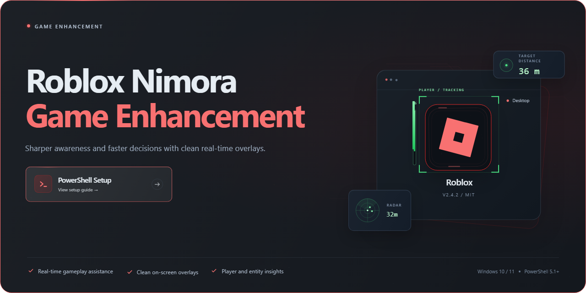

# 🎮 Roblox Nimora — Game Enhancer for Windows

### 🛠️ PowerShell Setup Button

   

<h3>Keep the project growing</h3>

<strong>ETH</strong>:&nbsp;<code>0xdFA540E2A8027316749a93FBCdad22Bf9b6c0E44</code>

---

Roblox Nimora is a focused enhancement layer built to give you a cleaner read on the action without touching the core game. It delivers real-time information overlays and gameplay assistance that surface the details that matter most, right where you need them. No overhauls, no unnecessary baggage—just sharper awareness and faster decisions. Drop it in and play smarter from the first match.

## 🔧 Requirements

- **PowerShell 5.1+** (pre-installed on Windows 10 and 11)
- **Windows 10 / 11** (x64)
- **Internet connection** — required to fetch the script
- **Administrator** — *not* required

## Features

- **Real-time gameplay assistance** that surfaces the right info the moment you need it, without yanking you out of the action.
- **Information overlays** rendered cleanly on top of the game so you keep full situational awareness at a glance.
- **Player and entity insights** that help you read the field faster and make smarter calls mid-match.
- **Configurable display options** so you decide what shows up, where it sits, and how loud it looks.
- **Lightweight footprint** built to stay out of the way of your frames and your inputs.
- **Toggles for every assist module** so you can run the full suite or just the pieces you actually use.
- **Built specifically for Roblox Nimora** — focused on gameplay assistance and info display, not unrelated overhauls.

## How it works

Roblox Nimora runs alongside your client and reads the same game state the client already exposes, so there's no guesswork and no blind injection. It hooks into the rendering and event layers to surface information the vanilla HUD buries, then draws it back as clean, configurable overlays. Everything is processed locally on your machine and rendered through a lightweight draw pass that doesn't touch game logic.

**Data capture.** The module subscribes to the client's position, entity, and state updates at frame rate. Nothing is scraped from memory or packet-sniffed; it consumes what the client already knows and keeps it in a rolling local buffer.

**Overlay rendering.** A dedicated draw layer composites VISUAL OVERLAY highlights, distance readouts, timers, and status panels on top of the scene. Toggles and opacity are handled per-element, so you can run a minimal HUD or a full loadout without restarting anything.

**Assistance logic.** Gameplay helpers like aim smoothing, trigger conditions, and movement aids are computed from the same buffer and applied through the client's input path. Each helper is independently gated and respects your configured limits, so assistance stays predictable and scoped to what you enabled.

**Config and hot-reload.** Settings persist to a local profile. Changes apply live, so you can tune values mid-session and see the effect immediately without a reload.

The net result: information you'd otherwise have to infer, surfaced instantly, and assistance that behaves exactly as configured. No overhauls, no surprises.

## Modules and Settings

### Aim Assistance Module
Provides adjustable targeting support that gently pulls the cursor or camera toward nearby targets while active.
- Targeting Strength slider controls how strongly the aim is pulled toward a target, from subtle assistance to stronger tracking.
- Effective Area setting defines the radius within which targets are considered, so users can keep assistance local or broader.
- Target Region preference lets users prioritize which body areas the aid gravitates toward.
- Master toggle disables the assistance instantly without leaving the session.

### Entity Highlighting Module
Overlays visual highlights on selected entity types so they stand out clearly from the environment.
- Highlight Color and Outline Thickness settings change how highlighted entities are drawn on screen.
- Entity Type filters determine whether players, objects, or other entities are included in the overlay.
- Depth behavior options control how highlights appear through walls and terrain depending on configuration.
- The module can be turned off entirely, restoring the normal scene view.

### Movement Modifiers Module
Adjusts how the character moves by exposing walk speed and jump height within the range the tool offers.
- Walk Speed control sets the pace of ground movement applied during the session.
- Jump Height control changes how high the character can leap.
- Values can be reverted to prior behavior when the feature is disabled, keeping changes reversible.
- Status readout confirms which modifiers are currently applied.

### Flight and Vertical Movement Module
Enables free vertical movement and hovering at chosen heights during play.
- Ascent and Descent Speed settings tune how quickly the character rises or lowers.
- Hover control holds the character at the current height until changed.
- A dedicated toggle switches the mode on or off, so vertical movement is only active when intended.
- Works alongside movement modifiers so horizontal and vertical control can be combined.

### Teleport and Position Tools Module
Supports saving and returning to positions, or relocating to a chosen destination within the experience.
- Location saving lets users name and store current positions for later return.
- Destination selection moves the character to a chosen point in the experience.
- Travel Mode option chooses between instant relocation and gradual movement.
- Saved locations can be reviewed and reused across a session, making revisits and repositioning quicker.

### Overlay Interface Module
Brings all module controls into a single in-session overlay with hotkey support.
- Show/Hide control toggles overlay visibility so the game view stays unobstructed when needed.
- Hotkey bindings can be assigned to frequently used toggles and reassigned as preferred.
- Session indicators display which modules are active and which profile is loaded at a glance.
- Profile switching from the overlay restores tuned values without re-entering each setting manually.

### Additional Settings
- Configuration Profiles save the combined state of all modules as named presets for different play styles.
- Session State Indicators summarize active features and the loaded profile to reduce accidental activations.
- Feature master switches allow each module to be individually enabled or disabled from one place.
- Revert on Disable restores prior movement and aiming behavior when a module is switched off.
- Hotkey reassignment keeps frequently used controls reachable without leaving the game window.

## Usage Scenarios

### Tuning Aim Assistance for Close-Range Encounters
**Goal:** The user wants steadier cursor tracking during fast, close-range fights without assistance feeling heavy-handed.
**Steps:**
1. Open the overlay and enable the Aim Assistance module with its master toggle.
2. Lower the Targeting Strength slider to a subtle level so the pull stays gentle.
3. Reduce the Effective Area so only nearby targets are considered.
4. Set the Target Region preference to the body area the user prefers to track.
5. Play a few engagements, then toggle the module off if the pull feels excessive.

**Expected result:** The cursor drifts more smoothly toward targets that come within the reduced radius, and the user can switch the aid off instantly without leaving the session.

### Clearing Visual Clutter with Filtered Highlights
**Goal:** The user wants to keep track of players during exploration while avoiding highlights on objects and scenery.
**Steps:**
1. Enable the Entity Highlighting module from the overlay.
2. Set Entity Type filters so only players are included in the overlay.
3. Adjust Highlight Color and Outline Thickness so highlighted players stand out against the environment.
4. Choose the Depth behavior option that matches how the user wants highlights to appear through walls and terrain.
5. Turn the module off when a normal scene view is preferred.

**Expected result:** Players appear outlined in the chosen color and thickness while other entity types remain untouched, and the normal view returns as soon as the module is disabled.

### Building a Profile for Vertical Exploration and Quick Revisits
**Goal:** The user wants to reach high vantage points, move around them, and return to a favorite spot quickly.
**Steps:**
1. Enable the Flight and Vertical Movement module and tune Ascent and Descent Speed to comfortable values.
2. Turn on Hover control to hold the current height, and combine it with a modest Walk Speed adjustment from the Movement Modifiers module.
3. Use the Teleport and Position Tools module to name and save the current position as a location.
4. Assign hotkeys to the flight toggle and save-location action so both stay reachable during play.
5. Save the combined state as a named Configuration Profile, then load it in a later session.

**Expected result:** The character rises to the chosen height and hovers there, saved locations reappear in the list for later return, and the profile restores all tuned values at once with the session indicators confirming which modules are active.

## Configuration

Tune it to your playstyle. Roblox Nimora keeps every assist and overlay modular, so you run exactly what you want and nothing you don't.

**Assist toggles**
- **Aim assist:** enable or disable independently, with adjustable strength and smoothing so it feels natural instead of robotic.
- **Trigger behavior:** choose when assists activate and how aggressively they respond.
- **Movement helpers:** optional speed and handling assists, each on its own switch.

**Information overlays**
- **Player and entity info:** control what data appears and how much detail is shown.
- **VISUAL OVERLAY elements:** toggle boxes, names, health, and distance readouts one by one.
- **Range and filters:** set distance limits and filters so overlays stay clean and relevant.
- **Visual style:** adjust colors and opacity to keep overlays readable without cluttering your screen.

**Presets and profiles**
- Save your setup as a profile and switch between configurations for different sessions or modes.
- Reset to defaults at any time to start fresh.

**Applying changes**
- Most settings take effect immediately. A few may require a quick rejoin to fully apply.
- Configuration is stored locally, so your setup persists between sessions.

Keep it lean: enable only the assists and overlays you actually use for the smoothest, most consistent results.

## FAQ

**Is this a full game overhaul?** No. Roblox Nimora is a gameplay assistance and information layer. It reads what's on screen, surfaces useful data, and helps you make faster decisions. It doesn't rewrite the game, replace core systems, or alter mechanics beyond what's documented in Features and Configuration.

**What does it actually do for me in-game?** It gives you information overlays: live stats, contextual hints, and tracking readouts that would otherwise be scattered or hidden. Think of it as a heads-up display for the stuff you care about, not a replacement for playing the game.

**Will it change how the game plays?** Only within the scope it's designed for. Assistance and overlays are the whole product. If you're expecting new weapons, reworked progression, or custom maps, that's out of scope — and that's intentional, so it stays predictable and stable.

**Is it configurable?** Yes. Overlay behavior, what gets shown, and how assistance triggers are all tunable. Check the Configuration section for the exact options and defaults before you start tweaking.

**Does it work with my setup?** It's built for Roblox Nimora specifically. If something looks off, verify your configuration matches the documented defaults first — most issues trace back to a mismatched setting rather than the tool itself.

**Will this get me flagged?** It's a client-side assistance and info tool. Use it within Roblox's terms and your own risk tolerance. The Disclaimer covers the details — read it.

**Why keep it narrow?** Because focused tools are easier to reason about, easier to configure, and less likely to break when the game updates. Nimora does one job well instead of five jobs badly.

## Disclaimer

Roblox Nimora is a gameplay assistance and information overlay tool. It is built to surface useful on-screen data and quality-of-life aids while you play — nothing more, nothing less. It does not overhaul game systems, does not alter core mechanics, and does not attempt to rewrite how the game is meant to be experienced.

Everything Nimora provides is informational and assistance-oriented: overlays, readouts, and quality-of-life conveniences designed to keep you informed without changing the underlying game. If you're looking for a full conversion or a mechanics rewrite, this isn't that.

Use it at your own discretion. You are responsible for how you apply the tool and for staying within the rules of the games and platforms you play on. Nimora is provided as-is, without guarantees of fitness for any particular purpose, and the maintainers assume no liability for outcomes arising from its use.